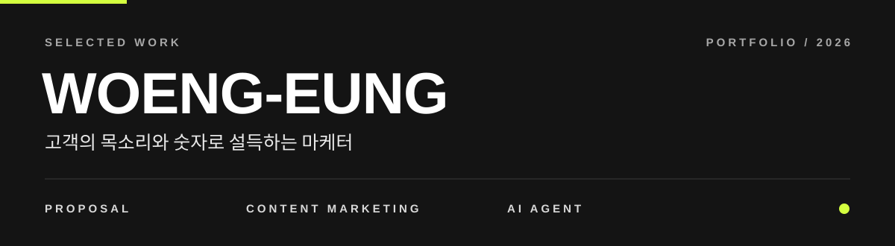

 

**욍읭** · CJ올리브네트웍스 LLM Academy 대전 1기

영업·마케팅·기획 업무를 Claude 에이전트 팀으로 자동화해 본 결과물을 모았습니다.
버튼을 누르면 결과물이 바로 열립니다.

 

`01` &nbsp;—&nbsp; **PORTFOLIO / MARKETING**

### 라라스윗 마케팅 인턴 포트폴리오

저당 간식 고객 후기와 광고를 AI와 함께 분석해, 근거 있는 마케팅 제안으로 묶은 지원 포트폴리오.

| 분석한 후기 | 분석한 광고 | 작성일 |
|:--|:--|:--|
| **8,498개** | **30개** | **2026.11.09** |

 

`02` &nbsp;—&nbsp; **PROPOSAL / AI REVIEW**

### 본투윈 × 무신사 성수 팝업 제안서

공식몰 리뷰를 분석하고, 기획팀 에이전트가 기획안을 쓰고, 무신사 MD 역할 에이전트가 검토하는 흐름으로 19번 고친 입점 제안서.

| 분석한 리뷰 | 버전 | 반영한 MD 피드백 |
|:--|:--|:--|
| **600건** | **v1 → v19** | **8건** |

 

`03` &nbsp;—&nbsp; **PROPOSAL / BEAUTY**

### 제로이드 × 무신사 뷰티 입점 제안서

MD 역할 리뷰어 에이전트로 검토·보완하는 방식을 처음 적용한 제안서.

 

`04` &nbsp;—&nbsp; **CONTENT / AI AGENT**

### 네이버 블로그 에이전트 팀

리서처 → 작가 → 이미지 제작 → 조립, 에이전트 4명이 메모 한 장으로 블로그 글 한 편을 완성합니다.

| 에이전트 | 테스트 글 |
|:--|:--|
| **4명** | **3편** |

 

`05` &nbsp;—&nbsp; **SHORT-FORM / REELS**

### 쓸데없이 신기한 — 인스타그램 잡지식 릴스

40초 안에 하나의 "왜?"를 풀어 주는 세로 영상 시리즈. 대본·장면·자막·영상 프롬프트를 담은 제작시트와 초안 영상.

| EP01 · 로마 콘크리트 | EP02 · 손가락 주름 |
|:--:|:--:|
|  |  |
| .mp4>)  | .mp4>)  |

 

---

<b>파일 위치 한눈에 보기</b>

 

같은 파일을 두 번 올리지 않도록 날짜마다 한 곳에만 두었습니다.

| 날짜 | 위치 | 내용 |
|---|---|---|
| 10/29 | 저장소 맨 위 `2026-10-29_제로이드-제안서/` | 제로이드 × 무신사 뷰티 입점 제안서 |
| 10/30 | 저장소 맨 위 `2026-10-30_본투윈-제안서/` | 본투윈 제안서 v14, 제로이드 제안서 v2, 20초 모션 영상 |
| 11/2 | 저장소 맨 위 `2026-11-02_본투윈-제안서-v19_블로그-에이전트팀/` | 본투윈 제안서 v19, 블로그 에이전트 팀과 테스트 글 2편 |
| 11/3 | 이 폴더 `1주차 결과물/블로그/output/2026-11-03_라라스윗-저당간식/` | 블로그 테스트 글 3번째 |
| 11/3 | 이 폴더 `1주차 결과물/Claude outputs/` | 릴스 EP01·EP02 제작시트, 초안 영상, 커버, 채널 세팅안 |
| 11/9 | 이 폴더 `2주차 결과물/포트폴리오/` | 라라스윗 마케팅 인턴 포트폴리오 (공개용 가명판) |

<b>알려 드립니다</b>

 

- 이 저장소의 제안서는 **LLM Academy 실습 과제**이며, 제안서에 나오는 실제 회사(제로이드, 본투윈, 무신사, 라라스윗 등)와는 **관계가 없습니다.**
- 제안서 속 담당자 이름·연락처는 실습용으로 넣은 것이며 실제 연락처가 아닙니다.
- 매출·주문 비중·목표 같은 **수치는 실습용 가상 수치**입니다. 실제 회사 데이터가 아닙니다.
- 상품·모델 사진의 저작권은 각 브랜드에 있습니다.
- 작성자 표기는 가명 **욍읭**을 사용합니다. 포트폴리오는 사진·연락처를 뺀 공개용 가명판입니다.
- `VIEW` 버튼은 raw.githack.com을 거쳐 HTML을 화면으로 보여 줍니다. 열리지 않으면 파일을 내려받아 크롬에서 열어 주세요.

